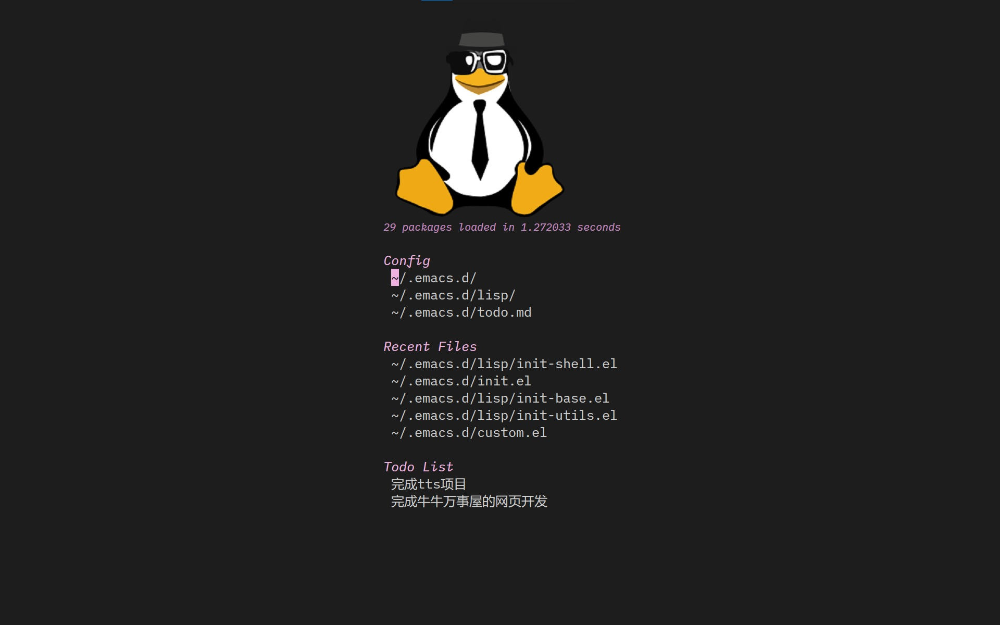
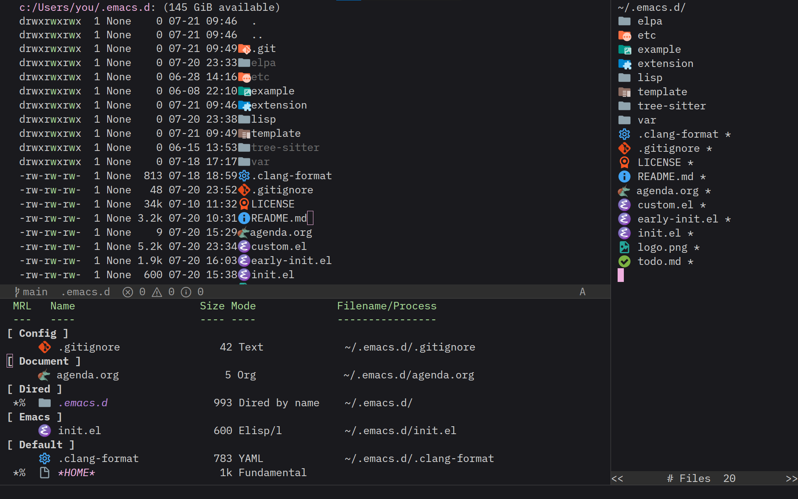
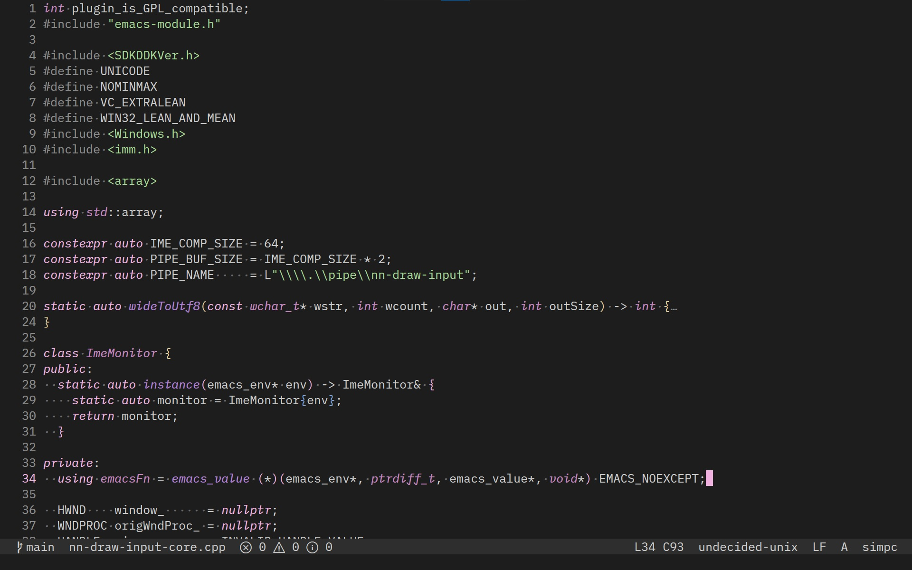

#+title: Elegant Emacs
#+property: header-args :eval never-export
#+startup: overview
#+attr_org: :center t

#+attr_org: :center t
[[https://img.shields.io/badge/Supports-Emacs_31+-purple.svg?style=flat-square&logo=GNU%20Emacs&logoColor=white]]
[[https://img.shields.io/badge/License-GPLv3-blue.svg?style=flat-square]]

* Introduction

Elegant Emacs is a personal, batteries-included Emacs configuration for GNU
Emacs 31 and newer.  It keeps configuration modules small under
=user-lisp/=, uses built-in Emacs features first, and adds packages only when
they improve everyday editing or development.  Startup work is deferred where
possible, while customization and persistent state remain easy to find in
=user-lisp/init-def.el= and =.nn=.

* Features

- *Fast startup and sensible defaults.* Expensive setup is deferred until the
  first input or file visit, so Emacs stays responsive while common editing and
  project state work out of the box.
- *Editing and appearance.* Completion, formatting, folding, multiple cursors,
  file and buffer management, font and icon fallback, and the =Catppuccin Mocha= dark
  theme make the editor comfortable for daily use.
- *Programming.* Tree-sitter modes cover C/C++, Emacs Lisp, JavaScript and
  TypeScript, web templates, shell, Org, Markdown, JSON, and YAML.  Eglot
  provides LSP navigation, renaming, references, and code actions; Flymake
  shows diagnostics; Dape and GDB handle debugging.
- *Projects and navigation.* Built-in Project support with ripgrep search,
  Git-aware navigation, xref, Citre/readtags, bookmarks, and Dired makes it
  easy to find and manage code and files.
- *Terminals and daily tools.* Ghostel provides a project-aware terminal,
  while Eshell, EWW, Org, translation, mail/news, and IRC cover common work
  without leaving Emacs.
- *Live Server.* The =live-server= package starts a small Python HTTP server
  for a selected directory, with configurable host and port, directory
  listings, and automatic browser reload when served files change.
- *Simple mpv.* The =simple-mpv= package plays files through the external
  =mpv= player, browses a configured audio directory, and provides an Emacs
  control buffer with metadata, progress, play/pause, previous/next, shuffle,
  loop, and seeking.  Use =C-c p= in Dired to play a file or =C-c m= to open
  the audio browser.

The most useful defaults are:

|---------------+-------------------------------|
| Key           | Action                        |
|---------------+-------------------------------|
| =<f1>=          | Format the current buffer     |
| =<f2>=          | Rename the current symbol     |
| =<f5>=          | Start Dape debugging          |
| =<f8>= / =S-<f8>= | Next / previous Flymake error |
| =<f12>=         | Jump to a definition or tag   |
| =C-c s=         | Search files in the project   |
| =C-`=           | Toggle the Ghostel terminal   |
| =C-<f1>=        | Show the =*HOME*= dashboard     |
|---------------+-------------------------------|
* Personal additions

- =which-key= shows available keys after a prefix such as =C-x= or =C-c=.
- Vertico, Orderless, and Marginalia provide a vertical command menu with
  descriptions. Search with space-separated words, for example =theme load=.
  In file prompts, =M-RET= accepts your typed path when creating a new file.
- Corfu keeps =RET= for newlines; =Tab= accepts a code completion.

| Key       | Action                           |
|-----------+----------------------------------|
| =C-x b=   | Search buffers with Consult      |
| =M-s l=   | Search lines in the current file |
| =M-s r=   | Search text in the project       |
| =C-==     | Expand the selected region       |
| =C-M-==   | Contract the selected region     |
| =C-c y=   | Choose a code snippet            |
| =C-c i=   | Toggle indentation guides       |

Indentation guides use the same colors as the rainbow brackets. The toggle
affects the current buffer; guides start enabled in programming modes.
Existing tab-indented lines also show guides when the mode inserts spaces;
code buffers show tab markers without drawing a marker for every space, which
keeps scrolling and editing responsive. When guides are off, the same key turns
on space markers so indentation can be inspected.

C++ snippets live under =etc/yasnippet/snippets/c++-mode/= and work with
=simpc-mode= C++ files, =c++-mode=, and =c++-ts-mode=. Triggers include =main=,
=acm=, =bits=, =cf=, =gcd=, =qpow=, =sort=, and =vec=. Type a trigger and press =Tab=,
or use =C-c y=. Within a snippet, =Tab= moves between editable fields.
=gcd= requires =<numeric>=; =sort= requires =<algorithm>=.

Handwritten personal preferences are in =user-lisp/init-local.el=;
=custom.el= holds settings saved through Customize. Startup temporarily raises
the garbage collection threshold to 128 MiB, then restores it to 32 MiB with
=gc-cons-percentage= set to 0.1.

* Requirements

This configuration supports only GNU Emacs 31 and newer.  A graphical frame is
recommended for fonts, icons, child frames, and the Dape toolbar; core editing
also works in a terminal frame.  Git is required for installation and
version-control integration.

Optional tools such as =ripgrep=, language servers, =gdb=, =aspell=,
=prettier=, =clang-format=, =shfmt=, Python, =mpv=, and a Bash executable
enable their corresponding integrations.  The first launch needs network
access so =use-package= can install missing packages; later launches use the
local package cache.

* Install

Clone into Emacs' conventional user directory and start Emacs normally:

#+begin_src sh
git clone https://github.com/zHaOdANiuu/.emacs.d.git ~/.emacs.d
#+end_src

No framework bootstrap command is required.  On the first launch, the
configuration creates its persistent state under =~/.emacs.d/.nn/=.  A
Codeberg mirror is available at
[[https://codeberg.org/zdn/.emacs.d.git][Codeberg]].
